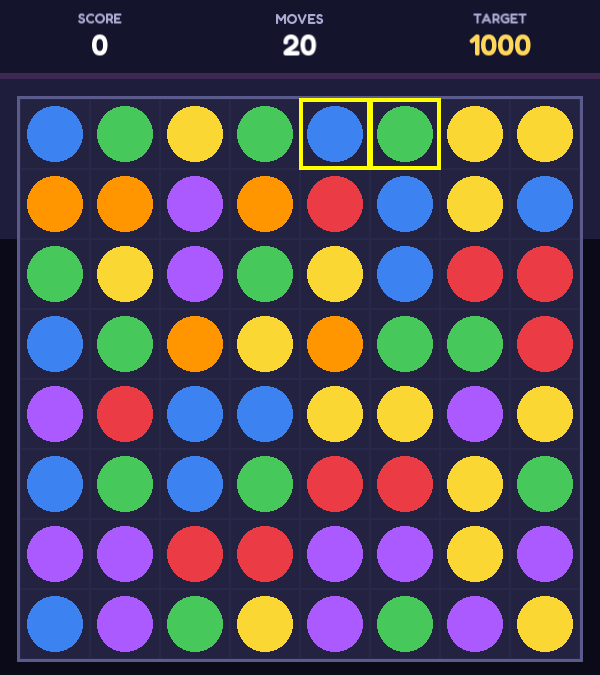

# Team IMF ( CANDY CRUSH )

**GitHub Repository:** `https://github.com/mahshafgill/team-imf-candy-crush`

# Team Contributions

----------------------------------------------------------------------------------------------------------------------------------------

 ----------------------
 |*Mahshaf*  25L-2502 |
 ----------------------
 |*Assigned Features* |
 ----------------------

 • Game Window & Input/Update/Draw Loop (F1)
 • Top HUD, Score/Moves/Target & Win/Loss Logic (F6)
 • Main Menu, Game States & End Screens (F7)
 • GitHub Repository Setup & Integration
 • Idle Move Hint & Deadlock Auto-Shuffle (Bonus) 
 --------------------------
 |*Functions Implemented* |
 --------------------------
main()
input()
update()
draw()
hud()
end()
endscr()
menu()
options()
bg()
bounce()
middletxt()
fmove()
shuffleboard()
hint_shuffle()

----------------------------------------------------------------------------------------------------------------------------------------

 -------------------
 |*Iman*  25L-2532 |
 ----------------------
 |*Assigned Features* |
 ----------------------

• Horizontal & Vertical 3+ Match Detection (F4)
• Candy Clearing, Scoring, Gravity Falling, Random Refill & Chain Cascades (F5) 

 --------------------------
 |*Functions Implemented* |
 --------------------------

findMatches()
clear_score()
dropcandies()
Refill()
chains()

----------------------------------------------------------------------------------------------------------------------------------------

 -------------------
 |*Faiqa* 25L-2522 |
 ----------------------
 |*Assigned Features* |
 ----------------------

• Level Loading from File & 8×8 Board Rendering (F2)
• Mouse Click Selection & Valid Neighbour Swapping (F3)
• Save & Continue Game Persistence (F8)

 -------------------------
 |*Functions Implemented*|
 -------------------------

loadLevel()
drawBoard()
trySwap()
handleBoardClick()
saveGame()
loadSavedGame()
clearSaveFile()

# Controls

 --------------------
 | Action | Control |
 --------------------
 ------------------------------------------------------------------------------------------------
 | Select a candy                   |   Left-click a candy on the board                         |
 | Swap candies                     |   Left-click an adjacent candy (up, down, left, or right) |
 | Menu navigation                  |   Up / Down arrow keys or Left-click, Enter to select     |
 | Save and return to menu          |   Esc (while playing)                                     |
 | Return to menu from end screen   |   Enter                                                   |
 ------------------------------------------------------------------------------------------------

## Screenshot

